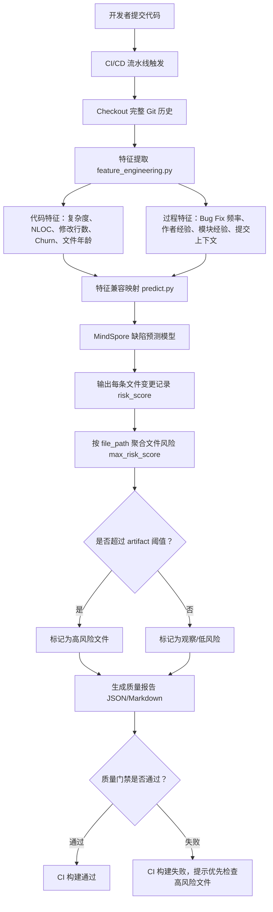
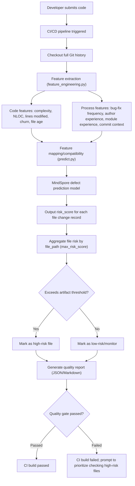
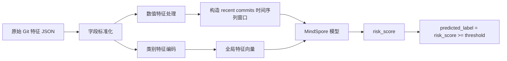
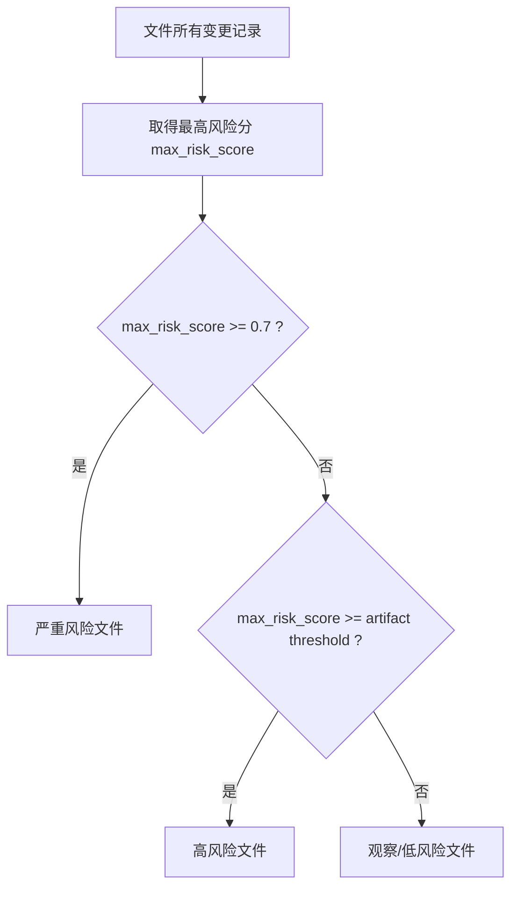
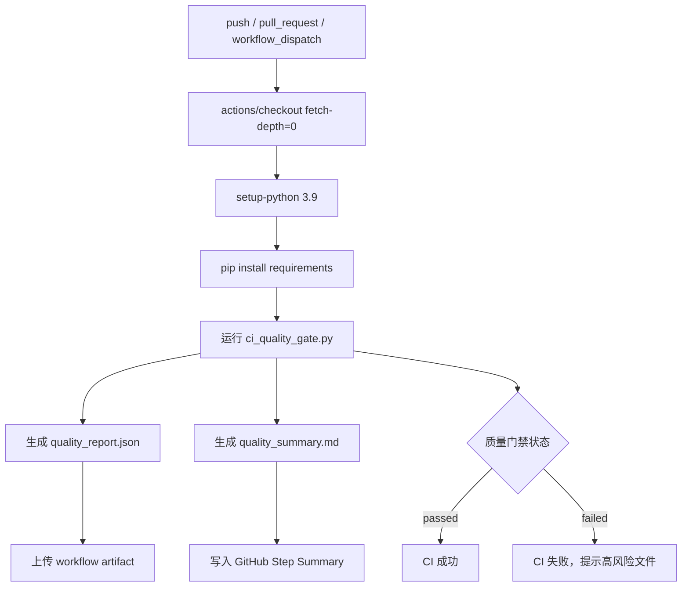

# Intelligent-Prediction-of-Code-Defects
本项目面向软件质量管理场景，目标是通过代码缺陷预测模型识别高风险文件，为测试人员提供测试优先级建议，并将质量检查能力接入 CI/CD 流水线。系统不是传统静态扫描器，而是基于 Git 变更历史、代码规模、作者经验、模块演化等特征进行风险预测。
This project is designed for software quality management. It employs a code defect prediction model to identify high-risk files, provides testers with recommendations on testing priorities, and integrates quality assessment capabilities into CI/CD pipelines. Unlike traditional static analysis tools, this system assesses risk based on factors such as Git change history, codebase size, author experience, and module evolution.

## 1. 项目背景 (Project Background)
在持续集成和持续交付场景中，测试人员通常需要面对大量提交、文件变更和回归测试任务。如果所有文件都平均投入测试资源，容易造成两类问题：
- 高风险代码没有被优先发现。
- 低风险代码消耗了过多测试时间。
本项目围绕“质量管理智能化”主题，构建了一个基于 Git 历史和代码度量特征的代码缺陷风险预测系统。系统通过训练缺陷预测模型，对目标 Git 仓库中的文件进行风险评分，并在 CI/CD 流水线中作为质量门禁，帮助测试人员优先定位高危代码。
本系统不是传统静态漏洞扫描器。它不直接判断某一行代码是否存在确定 bug，而是根据文件的历史变更模式、复杂度、改动规模、Bug 修复频率和开发经验等特征，预测哪些文件更可能存在质量风险。

In continuous integration and continuous delivery (CI/CD) environments, testers often face a high volume of code commits, file modifications, and regression testing tasks. Allocating testing resources uniformly across all files can lead to two primary issues:
- High-risk code may not be identified as a priority.
- Low-risk code may consume a disproportionate amount of testing time.
Focused on the theme of "intelligent quality management," this project develops a system for predicting code defect risks based on Git history and code metrics. By training a defect prediction model, the system assigns risk scores to files within a target Git repository. These scores serve as quality gates within the CI/CD pipeline, enabling testers to prioritize the identification of high-risk code.
This system is not a traditional static vulnerability scanner. Rather than determining whether a specific line of code contains a definitive bug, it analyzes factors such as a file’s historical change patterns, complexity, scale of modifications, frequency of bug fixes, and the development experience associated with it, to predict which files are most likely to harbor quality risks.

## 2. 项目目标 (Project Objectives)
本项目目标包括：
1. 从真实 Git 仓库中自动提取代码质量相关特征。
2. 使用 MindSpore 训练代码缺陷预测模型。
3. 对目标仓库输出文件级风险分数和高风险文件列表。
4. 给出风险原因和测试/修复建议。
5. 将模型检测能力集成进 CI/CD 流水线，形成自动化质量门禁。
The objectives of this project include:
1. Automatically extracting code quality-related features from actual Git repositories.
2. Training a code defect prediction model using MindSpore.
3. Generating file-level risk scores and a list of high-risk files for target repositories.
4. Providing the rationale behind the identified risks, along with recommendations for testing or remediation.
5. Integrating the model’s detection capabilities into CI/CD pipelines to establish automated quality gates.

## 3. 总体系统流程 (Overall System Workflow)



## 4. 特征工程设计 (Feature Engineering Design)
系统核心输入不是单纯的源码文本，而是 Git 历史和代码度量特征的组合。当前特征主要分为两类。
The core input for the system is not merely source code text, but a combination of Git history and code metric features. The current features are primarily categorized into two types.

### 4.1 代码特征

代码特征用于描述文件本身的复杂度和变更规模：

| 特征 | 含义 | 风险解释 |
|---|---|---|
| `added_lines` | 本次提交新增行数 | 新增越多，潜在引入缺陷的概率越高 |
| `deleted_lines` | 本次提交删除行数 | 删除越多，说明改动影响面可能更大 |
| `churn` | `added_lines + deleted_lines` | 代码变更强度，常用于缺陷预测 |
| `cyclomatic_complexity` | 圈复杂度 | 分支越多，测试覆盖越困难 |
| `nloc` | 有效代码行数 | 文件越大，维护和理解成本越高 |
| `maintainability_index` | 可维护性指数 | 越低表示代码越难维护 |
| `file_age_days` | 文件存活时间 | 新文件或频繁变化文件可能更不稳定 |

### 4.2 过程特征

过程特征用于描述开发过程中的风险信号：

| 特征 | 含义 | 风险解释 |
|---|---|---|
| `is_bug_fix` | 提交信息是否像 Bug Fix | 修复类提交说明相关区域曾出现问题 |
| `recent_bug_fix_count_90d` | 文件最近 90 天 Bug Fix 次数 | 越频繁说明文件可能是缺陷热点 |
| `module_bug_fix_count_90d` | 模块最近 90 天 Bug Fix 次数 | 模块整体质量风险 |
| `author_total_commits_before` | 作者历史提交经验 | 经验较低时需要更多 review |
| `module_owner_experience_before` | 作者在该模块的经验 | 模块经验不足容易遗漏业务约束 |
| `nf` | 本次提交影响文件数 | 提交影响面越广，回归风险越高 |
| `ns` | 本次提交影响子系统数 | 跨模块变更容易产生集成问题 |
| `nd` | 本次提交影响目录数 | 目录分散说明改动范围扩大 |
| `entropy` | 改动分散程度 | 改动越分散，定位和测试越困难 |

## 5. 模型方案

当前系统使用 MindSpore 构建缺陷预测模型。项目中推荐使用的模型产物为：

```text
artifacts/jitline/recent5_bestctx
```

该模型不是传统静态扫描规则，也不是人工指定的简单阈值规则，而是基于训练数据学习到的风险判断函数。模型输入为结构化特征，输出每条文件变更记录的风险分数：

```text
risk_score ∈ [0, 1]
```

可以将 `risk_score` 理解为：模型认为该文件变更记录具有缺陷风险的倾向程度。

### 5.1 模型预测流程



### 5.2 文件级风险聚合

模型首先对“文件变更记录”打分，而不是直接对文件打分。同一个文件可能在多个提交中出现，因此系统需要按文件聚合。

当前文件风险计算方式为：

```text
file_risk_score = max(risk_score of all records for the same file_path)
```

也就是说，如果某个文件在历史变更中有一次表现出较高风险，那么该文件会被优先列入风险文件列表。

## 6. 高风险文件判定口径

系统已修复高风险判定口径，使页面、后端报告和 CI/CD 门禁保持一致。

当前推荐 artifact 的阈值文件为：

```text
artifacts/jitline/recent5_bestctx/threshold.json
```

其中阈值为：

```text
0.2
```

因此当前判定规则为：

```text
max_risk_score >= 0.2  => 高风险文件
max_risk_score >= 0.7  => 严重风险文件
```

这里的 `0.2` 来自模型 artifact，而不是页面写死的阈值。`0.7` 仅作为更严格的严重风险展示阈值。



## 7. 哪些文件容易被判定为高风险

一个文件更容易被模型判为高风险，通常不是因为单个指标异常，而是多个风险信号共同出现。例如：

- 最近提交中该文件改动频繁。
- 单次修改行数较大，`churn` 较高。
- 文件或模块最近 90 天 Bug Fix 较多。
- 提交影响多个文件、目录或模块，改动范围分散。
- 文件代码量大，圈复杂度较高。
- 作者在项目或模块上的历史经验较低。
- 同一文件在多次提交中重复被模型判为风险记录。

需要强调的是，模型并不是执行如下简单规则：

```text
if churn > 80 then high risk
```

而是综合多个特征，通过训练得到的模型参数计算风险分数。

## 8. Web 可视化系统

当前系统提供 Streamlit 页面作为可视化入口：

```text
http://localhost:8512
```

页面支持：

- 输入本地 Git 仓库路径。
- 输入 Git URL。
- 上传包含 `.git` 历史的 zip。
- 选择模型 artifact。
- 查看质量结论摘要。
- 查看高风险文件数、严重风险文件数和风险阈值。
- 查看 Top 风险文件表。
- 查看风险原因和修复建议。
- 下载 JSON/CSV 结果。

页面中的质量结论基于模型阈值生成。例如：

```text
本次共分析 N 个文件，按当前 artifact 阈值 0.2000 识别出 X 个高风险文件。
```

## 9. CI/CD 集成方案

为了实现质量管理智能化，项目新增了 CI/CD 质量门禁脚本：

```text
ci_quality_gate.py
```

该脚本可以在流水线中直接运行：

```bash
python ci_quality_gate.py \
  --repo . \
  --artifacts artifacts/jitline/recent5_bestctx \
  --project-name local_repo \
  --top-n 20 \
  --output ci_reports/quality_report.json \
  --markdown-output ci_reports/quality_summary.md \
  --max-high-risk-files 0 \
  --max-severe-risk-files 0
```

脚本会输出：

- JSON 质量报告。
- Markdown 质量摘要。
- 命令行质量门禁结果。
- CI 退出码。

退出码定义：

| 退出码 | 含义 |
|---|---|
| `0` | 质量门禁通过 |
| `1` | 质量门禁失败 |
| `2` | 仓库分析失败或输入错误 |

### 9.1 GitHub Actions 工作流

项目已加入 GitHub Actions 示例：

```text
.github/workflows/code-quality-inspection.yml
```

流水线流程如下：



该集成方式使模型真正进入软件交付流程：当高风险文件超过门禁限制时，CI/CD 构建失败，测试人员可以优先检查报告中的 Top 风险文件。

## 10. 当前测试结果

### 10.1 `stml/welcomejs`

测试仓库：

```text
C:\Users\admin\Desktop\Code Quality Inspection\test_repos\stml_welcomejs
```

CI 门禁结果：

```text
status=passed
analyzed_files=7
high_risk_files=0
severe_risk_files=0
avg_file_risk=0.1650
risk_threshold=0.2000
exit_code=0
```

说明：该仓库在当前模型和阈值下没有命中高风险文件。

### 10.2 `pypa/sampleproject`

测试仓库：

```text
C:\Users\admin\Desktop\Code Quality Inspection\test_repos\pypa_sampleproject
```

CI 门禁结果：

```text
status=failed
analyzed_files=20
high_risk_files=12
severe_risk_files=0
avg_file_risk=0.2182
risk_threshold=0.2000
exit_code=1
```

说明：该仓库中有 12 个文件的 `max_risk_score` 超过 artifact 阈值，因此质量门禁失败。测试人员应优先查看报告中的 Top 风险文件。

## 11. 当前系统优势

当前系统已经具备以下能力：

- 能从真实 Git 仓库自动提取特征。
- 能结合代码特征和过程特征进行风险预测。
- 能输出文件级风险排序。
- 能生成风险原因和修复建议。
- 能通过 Web 页面展示分析结果。
- 能通过 CI/CD 脚本形成自动质量门禁。
- 能输出 JSON 和 Markdown 报告，便于流水线归档。

## 12. 当前局限

系统仍存在以下局限：

1. 当前模型输出的是文件级风险，不是行级 bug 定位。
2. 当前系统不是静态漏洞扫描器，不能直接识别 SQL 注入、空指针等具体漏洞。
3. repo 特征到训练 schema 存在兼容映射，部分字段是近似或默认值。
4. 高风险结果应被理解为测试优先级建议，而不是确定性缺陷结论。
5. 模型效果依赖训练数据质量和阈值选择。

## 13. 后续改进方向

后续可以从以下方面增强：

1. 增加 PR 级分析，只分析本次 PR 涉及的文件。
2. 在 GitHub Actions 中自动评论 PR，展示高风险文件。
3. 引入静态分析器结果作为额外特征，例如 Bandit、ESLint、Pylint。
4. 增加模型对比实验，例如 Random Forest、XGBoost、LSTM 的效果比较。
5. 增加阈值配置页面，使用户可以按项目风险偏好调整质量门禁。
6. 增加行级定位或函数级风险聚合，提高测试人员排查效率。

## 14. 总结

本项目实现了一个面向 CI/CD 的智能质量管理原型系统。它通过 Git 历史、代码复杂度、变更规模、Bug Fix 频率和开发经验等特征，使用 MindSpore 缺陷预测模型生成文件级风险分数，并将风险结果集成到 Web 页面和 CI/CD 质量门禁中。

系统当前最适合的定位是：

```text
基于模型的高风险文件排序与测试优先级推荐系统
```

它可以帮助测试人员在大量变更中快速发现更值得优先检查的文件，从而提升测试效率和项目质量。
